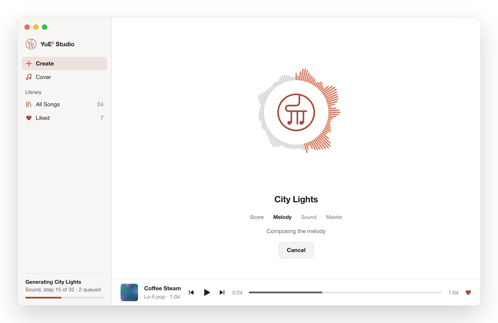

# YuE² Studio

YuE² Studio is an unofficial macOS app for the YuE2 open music model. It turns a style and lyrics into a song. It also turns an uploaded audio into a cover (like Suno Remix).

Everything runs privately on your Mac. The first run downloads the engine and the models. After that, generation runs locally and does not need a network connection to execute.

<p align="center"></p>

| Create | Library |
|---|---|
|  |  |
| **Cover** | **First run** |
|  |  |

Screens from the approved design ([design/proposal.html](design/proposal.html)), which the app follows.

## What it does

- **Create**: write a style and lyrics, then generate a song.
- **Cover**: upload a recording (wav, flac, mp3 or ogg) and generate a new version in the style and lyrics you choose.
- **Library**: keep every song. Play, like, rename, delete and export the audio. Reuse the style and lyrics of a song in Create. Queue more songs while one is generating.
- **Stems**: split a finished song into six tracks (drums, bass, vocals, guitar, piano, other) with [Demucs](https://github.com/facebookresearch/demucs) (`htdemucs_6s`). In Library, open a song's menu and choose **Extract Stems**; the files (FLAC, same sample rate as the song) open in Finder, in the song's `stems` folder. A 2.5 minute song takes about 15 seconds. Upstream notes that the piano stem of this model is the least accurate.

## System requirements

- Mac with Apple Silicon (M1 or later)
- macOS 14 or later
- Memory: 24 GB of RAM
- 18 GB of free disk space (25 GB recommended).
- Internet connection for the downloading the models the first time

## Install

1. Download [YuE2-Studio.dmg](https://github.com/neokree/yue-studio/releases/download/v0.1.0/YuE2-Studio-0.1.0.dmg)
2. Drag **YuE² Studio** into the **Applications** folder.
3. Open the app from Applications. 

## Opening the app the first time

The app is ad-hoc signed and is not notarized by Apple. macOS blocks it the first time you open it. Use one of these steps.

**System Settings:**

1. Try to open the app once. macOS shows a warning.
2. Open **System Settings**, then **Privacy & Security**.
3. Find the message about "YuE² Studio" and click **Open Anyway**. Enter your password if asked.

**Right-click:** on some macOS versions you can right-click the app in Applications and choose **Open**. If that does not work, use the System Settings steps.

**Geek version:** Execute this command over the terminal. Run it only on the copy you installed from the dmg.

```
xattr -dr com.apple.quarantine "/Applications/YuE² Studio.app"
```

## First run

On first launch the app installs every requirements does it needs. Ensure you have at least 18 GB free in your disk.

## Engine: MLX on Apple Silicon

Song generation has two engines. Both use the official YuE2 weights from [m-a-p](https://huggingface.co/m-a-p) at pinned revisions, with the same sampling, seeds and 32 acoustic steps.

- **MLX** (default on Apple Silicon with 24 GB of memory or more): the token stages (score and melody) run in [MLX](https://github.com/ml-explore/mlx) with 8-bit weights (affine, group size 64: embeddings, attention, MLP and output head; norms and rotary embeddings are not quantized). The acoustic stage runs in MLX in bf16, not quantized. The audio decoder is unchanged. The 8-bit weights are made once on your Mac from the official weights during setup (about 2.3 GB). No third-party weights are downloaded.
- **PyTorch**: the upstream engine, as in earlier versions. It is used on Macs with less than 24 GB, when MLX is not installed, if MLX fails to load, or when you choose it.

To choose the engine, quit the app and either start it with `YUE2_STUDIO_ENGINE=torch` (or `mlx`, or `auto`) in the environment, or write `{"engine": "torch"}` to `~/Library/Application Support/YuE2 Studio/engine.json`. The environment variable wins. If you choose PyTorch before an update, setup does not build the 8-bit weights; switching back to MLX later then quantizes them at every load (same weights, slower start) until the next model update (or until you run `engine/modelset.py migrate --data-dir <data folder>` with the app's Python, `<data folder>/venvs/yue2/bin/python`). `YUE2_STUDIO_NAR_ENGINE` (or `"nar_engine"` in the same file) changes only the acoustic stage. Each song's `result.json` records the token engine under `timing` (`execution`: `mlx-q8` or `eager`) and, under `timing.load`, whether the MLX acoustic stage was loaded (`mlx_nar_seconds`).

8-bit weights are an approximation of the bf16 weights. YuE2 has no published quality benchmark for them yet. `tool/bench_mlx.py` measures speed and how often the 8-bit engine picks the same token as PyTorch.

## Updating

Open the new version. The setup screen appears once and shows what is left to install; press **Install**. The app compares the models you have with the models the new version needs:

- models you already have at the right revision are kept, not downloaded again;
- only missing files are downloaded, and every file is checked against its published hash; an interrupted update continues where it stopped;
- the 8-bit MLX weights are built from the official weights (Apple Silicon only);
- the app switches to the new set only when all of it is verified. Only after that does it delete model files that no version needs anymore.

Your songs and the library are never touched by an update.

## Uninstall

1. Quit the app.
2. Delete **YuE² Studio** from Applications.
3. Delete the folder `~/Library/Application Support/YuE2 Studio`.

Step 3 also deletes all your songs and the models. Export the songs you want to keep before you delete the folder.

## Development

Requirements: Flutter through `fvm`, version 3.44.3 (pinned in `.fvmrc`). Docker for the end-to-end test. Apple Silicon Mac for the real engine run.

```
fvm use 3.44.3                                  # only if .fvmrc is missing
tool/fetch_uv.sh                                # pinned uv into assets/uv, sha256 checked
docker build -t yue2-studio-test:3.44.3 docker  # once, not per run
```

Python is run only through `uv`. The app keeps its downloads in its own data folder and does not use the Hugging Face cache.

Scripts in `tool/`:

- `tool/test.sh [--only unit|py|e2e]` runs three layers. Unit and widget tests with `fvm flutter test` (60 s budget). Sidecar tests with pytest through `uv` (20 s budget). The end-to-end test in Docker on Linux with Xvfb (3 min budget). Screenshots go to `build/e2e-shots/`. The first e2e run compiles the Linux app and gets 10 minutes.
- `tool/real_engine.sh [--fresh] [data dir]` runs the real engine on an Apple Silicon Mac. It downloads the models, then generates one song, one transcription and one cover. Default data dir: `.scratch/real-data`. `--fresh` wipes it first. Log: `.scratch/real-engine.log`.
- `tool/bench_mlx.py` compares the engines on an Apple Silicon Mac with the installed models: load time, ms per token for score and melody, acoustic and decoder time, total time for one fixed song and seed, and teacher-forced token agreement with the PyTorch bf16 reference. Run it with the app's Python: `"$DATA/venvs/yue2/bin/python" tool/bench_mlx.py --data-dir "$DATA" --engines torch,mlx-q8,mlx-bf16 --out /tmp/yue2-bench` (`DATA=~/Library/Application\ Support/YuE2\ Studio`). Options: `--cot off|melody|full`, `--seed`, `--semantic-max-tokens` for a shorter run.
- `tool/make_dmg.sh` builds the release app, signs it ad-hoc and writes `dist/YuE2-Studio-<version>.dmg`. It publishes nothing.
- `tool/fetch_uv.sh [--force]` downloads the pinned uv for Apple Silicon, checks its sha256 and writes `assets/uv/uv`. That file is gitignored.

The engine protocol is in `engine/PROTOCOL.md`.
