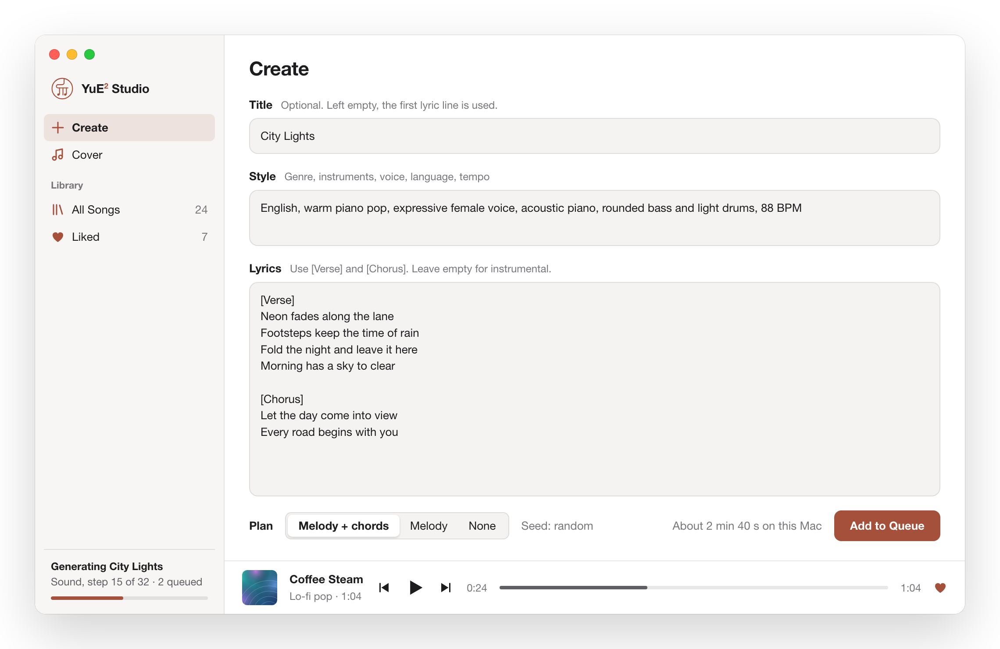
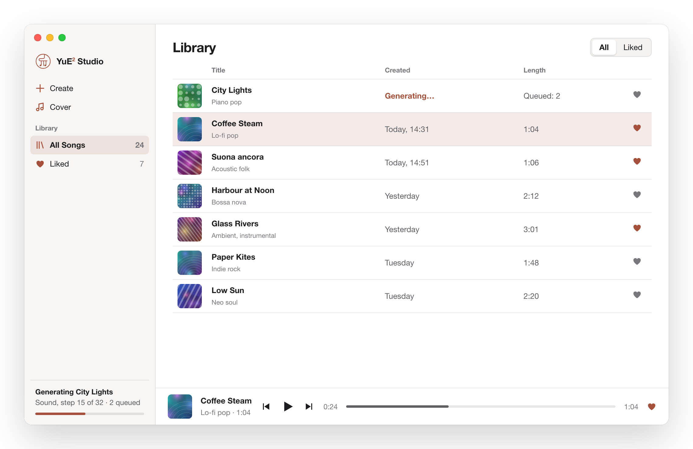
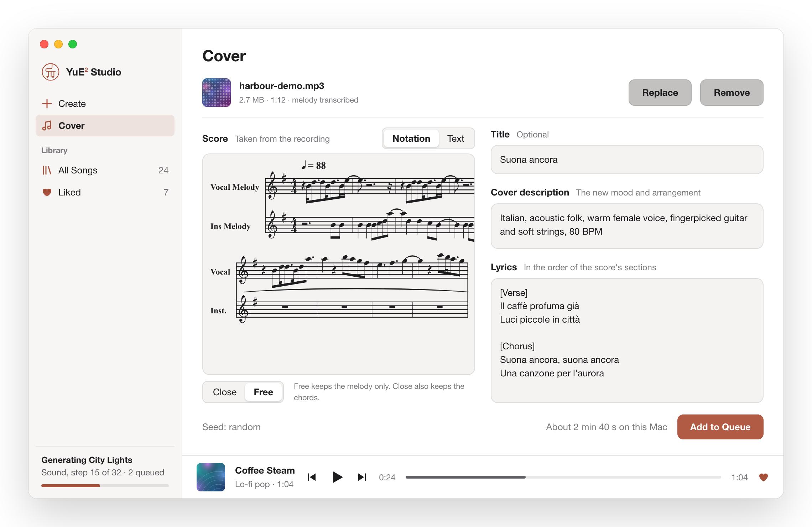
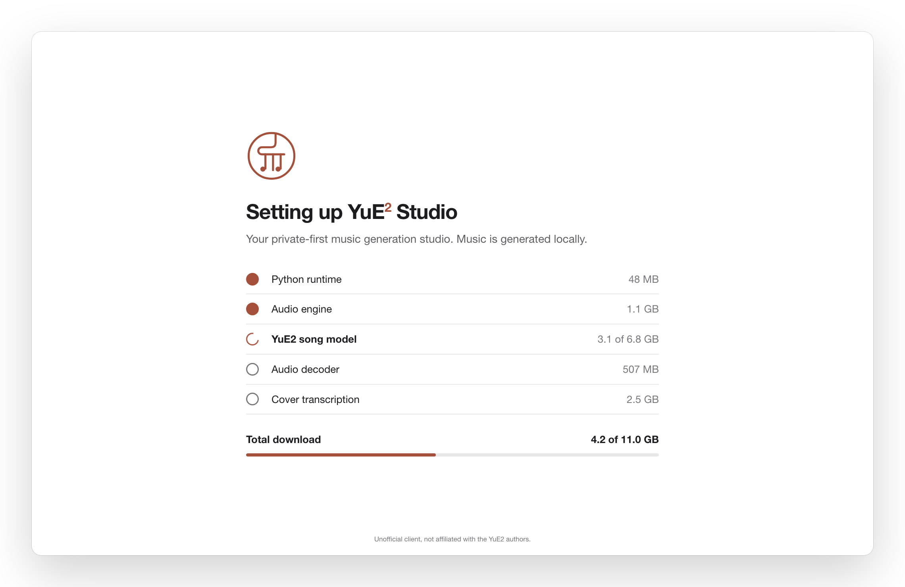

# YuE² Studio

YuE² Studio is an unofficial macOS app for the YuE2 open music model. It turns a style and lyrics into a song. It also turns an uploaded audio into a cover (like Suno Remix).

Everything runs privately on your Mac. The first run downloads the engine and the models. After that, generation runs locally and does not need a network connection to execute.

<p align="center"></p>

| Create | Library |
|---|---|
|  |  |
| **Cover** | **First run** |
|  |  |

Screens from the approved design ([design/proposal.html](design/proposal.html)), which the app follows.

## What it does

- **Create**: write a style and lyrics, then generate a song.
- **Cover**: upload a recording (wav, flac, mp3 or ogg) and generate a new version in the style and lyrics you choose.
- **Library**: keep every song. Play, like, rename, delete and export the audio. Reuse the style and lyrics of a song in Create. Queue more songs while one is generating.

## System requirements

- Mac with Apple Silicon (M1 or later)
- macOS 14 or later
- Memory: 24 GB of RAM
- 15 GB of free disk space (25 GB recommended).
- Internet connection for the downloading the models the first time

## Install

1. Download [YuE2-Studio.dmg](https://github.com/neokree/yue-studio/releases/download/v0.1.0/YuE2-Studio-0.1.0.dmg)
2. Drag **YuE² Studio** into the **Applications** folder.
3. Open the app from Applications. 

## Opening the app the first time

The app is ad-hoc signed and is not notarized by Apple. macOS blocks it the first time you open it. Use one of these steps.

**System Settings:**

1. Try to open the app once. macOS shows a warning.
2. Open **System Settings**, then **Privacy & Security**.
3. Find the message about "YuE² Studio" and click **Open Anyway**. Enter your password if asked.

**Right-click:** on some macOS versions you can right-click the app in Applications and choose **Open**. If that does not work, use the System Settings steps.

**Geek version:** Execute this command over the terminal. Run it only on the copy you installed from the dmg.

```
xattr -dr com.apple.quarantine "/Applications/YuE² Studio.app"
```

## First run

On first launch the app installs every requirements does it needs. Ensure you have at least 14GB free in your disk.

## Uninstall

1. Quit the app.
2. Delete **YuE² Studio** from Applications.
3. Delete the folder `~/Library/Application Support/YuE2 Studio`.

Step 3 also deletes all your songs and the models. Export the songs you want to keep before you delete the folder.

## Development

Requirements: Flutter through `fvm`, version 3.44.3 (pinned in `.fvmrc`). Docker for the end-to-end test. Apple Silicon Mac for the real engine run.

```
fvm use 3.44.3                                  # only if .fvmrc is missing
tool/fetch_uv.sh                                # pinned uv into assets/uv, sha256 checked
docker build -t yue2-studio-test:3.44.3 docker  # once, not per run
```

Python is run only through `uv`. The app keeps its downloads in its own data folder and does not use the Hugging Face cache.

Scripts in `tool/`:

- `tool/test.sh [--only unit|py|e2e]` runs three layers. Unit and widget tests with `fvm flutter test` (60 s budget). Sidecar tests with pytest through `uv` (20 s budget). The end-to-end test in Docker on Linux with Xvfb (3 min budget). Screenshots go to `build/e2e-shots/`. The first e2e run compiles the Linux app and gets 10 minutes.
- `tool/real_engine.sh [--fresh] [data dir]` runs the real engine on an Apple Silicon Mac. It downloads the models, then generates one song, one transcription and one cover. Default data dir: `.scratch/real-data`. `--fresh` wipes it first. Log: `.scratch/real-engine.log`.
- `tool/make_dmg.sh` builds the release app, signs it ad-hoc and writes `dist/YuE2-Studio-<version>.dmg`. It publishes nothing.
- `tool/fetch_uv.sh [--force]` downloads the pinned uv for Apple Silicon, checks its sha256 and writes `assets/uv/uv`. That file is gitignored.

The engine protocol is in `engine/PROTOCOL.md`.
